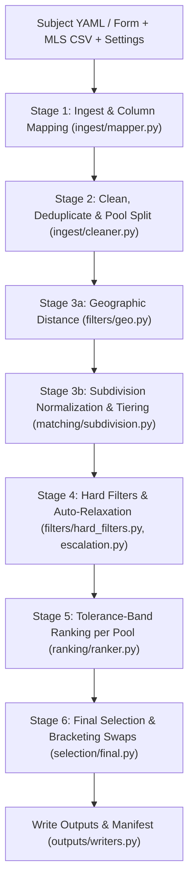

# System Documentation (`comps-pipeline`)

## 1. Overview

`comps-pipeline` is a local, deterministic residential appraisal shortlisting engine and Django web application. Given an MLS (Multiple Listing Service) CSV export and a subject property, it executes a 6-stage pipeline to produce:

- A ranked **Sold Shortlist** (default up to 30 sold comps, minimum 20 before rule relaxation).
- A ranked **Listing Shortlist** (default up to 10 active, option, or pending listings).
- A **Final Selection** (default 5 sold comps + 1 active/option/pending listing) that brackets the subject property above and below on configured attributes (`gla`, `lot`, `age`, `beds`, `baths`).
- A complete, immutable **audit package** (`data/output/<run_id>/`) containing CSV/JSON selections, excluded rows with every failing rule, diagnostic flags, a line-by-line decision log (`audit.jsonl`), and a run manifest with SHA-256 input hashes and stage timings.

---

## 2. Core Design Principles

1. **Deterministic Python Math:** Every distance, filter boundary, tolerance band, rank, and bracketing swap is computed in Python. Identical inputs and settings always produce byte-identical `shortlist.json`, `final_selection.json`, `excluded.csv`, `flags.json`, and `audit.jsonl`.
2. **Never Guess or Impute:** Missing or unparseable values become `Cell(value=None)` paired with an explicit `Flag` (`MISSING_REQUIRED_FIELD` or `INVALID_VALUE`). Nothing is defaulted or silently rounded.
3. **Exact Boundary Arithmetic:**
   - Gross Living Area (GLA) brackets compare scaled integers (`living_area * 100` vs `subject_gla * (100 ± pct)`), avoiding IEEE-754 floating-point boundary drops.
   - Lot sizes (`sqft / 43,560` or `acres`), bathroom totals (`full + half / 2`), and ranking tolerance buckets use exact `fractions.Fraction` arithmetic.
4. **Zero Hardcoded Thresholds:** Every business rule lives in `config/settings.yaml`, `config/column_mapping.yaml`, and `config/subdivision_aliases.yaml`. Pydantic schemas enforce `extra="forbid"` and require every threshold and flag severity to be explicitly present.
5. **Reference Date Determinism:** Sale lookback windows and future-date checks are measured against `subject.effective_date` (the appraisal effective date), never the system clock.
6. **Database-Free Web UI:** The Django interface (`web/`) has no database (`DATABASES = {}`). It validates forms, runs `pipeline.run()`, and renders past runs directly from the files in `data/output/<run_id>/`.

---

## 3. Repository Layout

```text
comps-pipeline/
├── run.bat                         # One-click Windows launcher (uv sync + Django server)
├── manage.py                       # Django management entry point
├── pyproject.toml                  # Dependencies (django, pydantic, pyyaml, rapidfuzz) & tool config
├── uv.lock                         # Locked dependency versions
├── config/
│   ├── settings.yaml               # All filter, escalation, ranking, selection & severity rules
│   ├── column_mapping.yaml         # Standard field -> candidate CSV column headers
│   ├── subdivision_aliases.yaml    # Canonical subdivision name -> confirmed alias variants
│   ├── subject.example.yaml        # Annotated template for subject property YAML files
│   └── README.md                   # Configuration reference guide
├── data/
│   ├── input/                      # Git-ignored folder for real client CSVs and subject.yaml
│   ├── samples/                    # Built-in 300-row Round Rock, TX benchmark CSV & subject.yaml
│   └── output/                     # Per-run output folders (<run_id>/)
├── src/comps_pipeline/
│   ├── pipeline.py                 # End-to-end stage orchestrator (pipeline.run)
│   ├── config/
│   │   ├── schema.py               # Strict Pydantic models for all configuration sections
│   │   └── loader.py               # YAML loader & validator
│   ├── models/
│   │   ├── cell.py                 # Generic Cell[T] wrapper (value, source, flag, note)
│   │   ├── comp.py                 # Comp model, STANDARD_FIELDS, lot_acres & total_baths helpers
│   │   ├── subject.py              # Subject property model
│   │   ├── flag.py                 # Flag, FlagReason, Severity, FlagOrigin, Source enums
│   │   ├── audit.py                # AuditEntry and Decision enum
│   │   └── run.py                  # RunManifest, Excluded, StageOutput containers
│   ├── ingest/
│   │   ├── mapper.py               # Raw text CSV reader (UTF-8 / cp1252) & header mapping
│   │   └── cleaner.py              # Field parsing, validation, deduplication & status pool split
│   ├── filters/
│   │   ├── geo.py                  # Haversine GPS distance & MLS reported distance fallback
│   │   ├── hard_filters.py         # GLA, lot, sale date, distance, subdivision & feature filters
│   │   └── escalation.py           # Cumulative step-by-step filter relaxation
│   ├── matching/
│   │   ├── normalize.py            # Subdivision text cleanup, Roman numerals & phase/unit extraction
│   │   └── subdivision.py          # 4-tier matching (exact, alias, fuzzy rapidfuzz, mismatch)
│   ├── ranking/
│   │   └── ranker.py               # Metric computation, tolerance-band bucketing & pool ranking
│   ├── selection/
│   │   └── final.py                # Top picks + strict-improvement bracketing swaps
│   └── outputs/
│       └── writers.py              # UTF-8-BOM CSV, JSON, JSONL & manifest writers
├── web/
│   ├── settings.py                 # Stateless local Django configuration
│   ├── urls.py                     # URL routing
│   ├── views.py                    # Views for new run, config editor, results, history & downloads
│   ├── forms.py                    # InputsForm, SubjectForm, RulesForm, ConfigForm
│   ├── static/app.css              # Studio stylesheet
│   └── templates/                  # base.html, new_run.html, config.html, results.html, history.html
├── tests/                          # Pytest suite (unit, integration, e2e, real format, web views)
└── docs/                           # Architecture overview, ADR decision log, open questions
```

---

## 4. Pipeline Architecture & Stage Specifications



### Stage 1: CSV Ingestion & Header Mapping (`ingest/mapper.py`)
- **Encoding:** Reads the CSV as raw strings (`utf-8-sig` first, falling back to Windows `cp1252` for Excel curly quotes). No automatic type or `NA` inference is performed.
- **Header Resolution (`suggest_mapping`):** Matches CSV headers against `config/column_mapping.yaml` case-insensitively and ignoring leading/trailing whitespace. The first matching candidate in each list wins.
- **Required Columns:** `mls_number`, `status`, `living_area`, and `subdivision_raw` must map to a column in the CSV, or an `InputError` is raised listing all available CSV headers.
- **Extras:** Every unmapped CSV column is preserved in `comp.extras: dict[str, Any]` so custom columns can still be used in `filters.required_features`.

### Stage 2: Cleaning, Deduplication & Status Pool Routing (`ingest/cleaner.py`)
- **MLS Number & Deduplication:** Rows with an empty `mls_number` are excluded (`MISSING_REQUIRED_FIELD`). Duplicate MLS numbers keep the first occurrence and exclude later rows (`DUPLICATE_LISTING`).
- **Status Pool Split:** `settings.status.pool_of(status)` routes each row into `"sold"` (default `S, SOLD, CLOSED`) or `"listing"` (default `A, ACTIVE, O, OPTION, OPTION PENDING, P, PENDING, AC, ACTIVE CONTINGENT, ACTIVE UNDER CONTRACT`). Any other status (Expired, Withdrawn, Cancelled, blank) is excluded (`STATUS_NOT_USED`).
- **Typed Cell Parsing:**
  - **Whole numbers (`parse_int`):** Strips `$` and `,`; accepts integral decimals like `$412,500.00` -> `412500`; rejects fractional values like `1850.5` with `INVALID_VALUE`.
  - **Prices & Living Area:** Must be `> 0`. `close_price` and `close_date` are required for `"sold"` rows only; `living_area` is required for all rows.
  - **Dates (`parse_date`):** Tried against `ingest.date_formats` in order (`%Y-%m-%d`, `%m/%d/%Y`, `%m/%d/%y`). For sold comps, `close_date > subject.effective_date` is rejected as `INVALID_VALUE`.
  - **Year Built:** Must satisfy `0 < year_built <= subject.effective_date.year`.
  - **Lot Size:** `lot_size_sqft` (`int > 0`) and `lot_size_acres` (`float > 0`). When both are present, square feet take precedence (`Fraction(sqft, 43560)`).
  - **Rooms:** `bedrooms`, `baths_full`, `baths_half` (`int >= 0`). Total baths = `baths_full + Fraction(baths_half, 2)` when both are known, else `None`.
  - **Coordinates & Distance:** `latitude` (`[-90, 90]`), `longitude` (`[-180, 180]`), and `reported_distance_miles` (`parse_miles` strips `miles`/`mile`/`mi`, `>= 0`).

### Stage 3a: Geographic Distance (`filters/geo.py`)
- If both the subject and the comp have `latitude` and `longitude`, computes great-circle distance in miles via the **Haversine formula** (`EARTH_RADIUS_MILES = 3958.8`) with `source = Source.COMPUTED`.
- Otherwise, if the CSV provided `reported_distance_miles`, uses that value with `source = Source.MLS`.
- Otherwise, sets `distance_miles` to `None` (`Source.NONE`) and raises a `NO_COORDINATES` flag.

### Stage 3b: Subdivision Normalization & Tiered Matching (`matching/normalize.py`, `matching/subdivision.py`)
- **Normalization (`normalize`):**
  1. Uppercases text and removes apostrophes.
  2. Converts `#2` after a phase/section/unit keyword into `PHASE 2` and bare `#2` (e.g. `Parkhill Terrace #2`) into `UNIT 2`.
  3. Replaces non-alphanumeric characters with spaces and separates glued numbers (`PH2` -> `PH 2`).
  4. Expands abbreviations (`PH`/`PHS` -> `PHASE`, `SEC`/`SECT` -> `SECTION`, `UT` -> `UNIT`) and Roman numerals `I`–`X` (`1`–`10`).
  5. Removes configured `matching.noise_words` (default `SUBDIVISION, SUBD, SUB, ADDN, ADDITION`) and filler words (`NO`, `NUM`, `NUMBER`) after `PHASE`/`SECTION`/`UNIT`.
- **Number Conflict Protection (`numbered_parts`):** Extracts `PHASE`, `SECTION`, and `UNIT` identifiers. If both the comp and subject specify the same keyword with different numbers (e.g., `PHASE 3` vs `PHASE 2`), the comp can **never** be Tier 0 or Tier 1, even if listed in manual aliases.
- **Tiers:**
  - **Tier 0 (Exact):** Normalized comp name equals normalized subject name (and no number conflict). Score = `100.0`.
  - **Tier 1 (Alias):** Normalized comp and subject map to the same canonical name in `config/subdivision_aliases.yaml` (and no number conflict). Score = `100.0`.
  - **Tier 2 (Uncertain / Fuzzy):** `rapidfuzz.fuzz.token_sort_ratio(comp, subject) >= filters.subdivision_min_score` (default `90`). Emits a `SUBDIVISION_UNCERTAIN` flag for appraiser review.
  - **Tier 3 (Mismatch):** Fuzzy score below `subdivision_min_score`.

### Stage 4: Hard Filters & Cumulative Auto-Relaxation (`filters/hard_filters.py`, `filters/escalation.py`)
All six hard filters run independently on the same candidate list so an excluded row records **every** rule it failed:
1. **`sale_date_window`:** Sold pool only. Keeps comps with `close_date >= months_before(subject.effective_date, sale_date_max_months)`. Unknown close dates follow `filters.missing_close_date` (`exclude` | `keep_and_flag`).
2. **`gla_bracket`:** Keeps comps within `±gla_bracket_pct%` of `subject.living_area` using exact integer math (`inclusive` controlled by `gla_bracket_inclusive`). Unknown GLA follows `filters.missing_gla`.
3. **`lot_bracket`:** Keeps comps within `±lot_bracket_pct%` of `subject.lot_acres()` using exact `Fraction` math. Skipped if subject lot size is unknown. Unknown comp lot size follows `filters.missing_lot`.
4. **`max_distance`:** Keeps comps with `distance_miles <= max_distance_miles`. Unknown distance follows `filters.missing_distance`.
5. **`subdivision_match`:** Only active when `require_subdivision_match: true`; keeps Tiers 0, 1, and 2, and excludes Tier 3 or unknown subdivisions.
6. **`required_features`:** Case-insensitive exact match against any standard field or unmapped CSV column in `comp.extras`.

**Escalation (`filter_with_escalation`):**
- Level `0` evaluates baseline `filters`.
- While kept **sold** comps `< run.min_shortlist_size` (default `20`), levels `1..N` apply `escalation.steps` cumulatively:
  - Step 1: `{ max_distance_miles: 4.0 }`
  - Step 2: `{ max_distance_miles: 5.0 }`
  - Step 3: `{ gla_bracket_pct: 30 }`
  - Step 4: `{ sale_date_max_months: 24 }`
- Each step used emits a `CRITERIA_RELAXED` flag, and all tried levels with their sold/listing counts are stored in `manifest.escalation_attempts`.

### Stage 5: Tolerance-Band Ranking (`ranking/ranker.py`)
- Sold and listing pools are ranked separately using the configured 7-key `ranking.hierarchy` (default `[subdivision, distance, gla, age, lot, beds, baths]`).
- For each key, values are grouped into integer buckets `floor(|diff| / Fraction(str(band)))`:
  - `subdivision`: `(0, subdivision_tier)`
  - `distance`: bucket by `tolerance_bands.distance_miles` (default `0.25` mi)
  - `gla`: `|gla_diff_pct|` bucket by `tolerance_bands.gla_pct` (default `5`%)
  - `age`: `|comp.year_built - subject.year_built|` bucket by `tolerance_bands.age_years` (default `5` yrs)
  - `lot`: `|lot_diff_pct|` bucket by `tolerance_bands.lot_pct` (default `10`%)
  - `beds`: `|comp.bedrooms - subject.bedrooms|` bucket by `tolerance_bands.beds_count` (default `1`)
  - `baths`: `|comp.total_baths() - subject.total_baths()|` bucket by `tolerance_bands.baths_count` (default `1`)
- Missing values get bucket `(1, 0)` so they sort after all known values `(0, bucket)` on that key.
- **Final Tie-Breakers:** Raw `distance_miles`, raw `|gla_diff_pct|`, and `mls_number` (guaranteeing a unique, deterministic total order).
- **Shortlist Cutoffs:** Top `run.shortlist_size` (30) sold comps and top `run.listing_shortlist_size` (10) listings are kept; lower ranks go to `excluded.csv` with `RANK_BEYOND_SHORTLIST`. If sold shortlist `< run.min_shortlist_size`, raises `SHORTLIST_BELOW_MINIMUM` (`BLOCKING`) naming the hard filter rule that removed the most rows.

### Stage 6: Final Selection & Subject Bracketing (`selection/final.py`)
- Starts with the top `selection.sold_count` (5) sold comps and top `selection.listing_count` (1) listing comp.
- Checks `selection.bracket_attributes` (default `[gla, lot, age, beds, baths]`). An attribute is bracketed if at least one selected comp is strictly above the subject and one is strictly below (or equal when `equal_counts_as_bracketed: true`).
- **Strict-Improvement Swaps:** While unbracketed attributes (`gaps`) remain, iterates through remaining shortlisted sold comps in rank order and tries swapping them for the lowest-ranked chosen sold picks (from worst rank to best). A swap is accepted if and only if the new set of gaps is a **strict subset** (`set(new) < set(current)`) of the current gaps, after which `chosen` is re-sorted by rank.
- Unfixable gaps emit `NOT_BRACKETED` flags; missing listings emit `NO_LISTING_COMP`.

---

## 5. Data Models & Flag Catalog

### Core Models (`src/comps_pipeline/models/`)
- **`Cell[T]`:** `{ value: T | None, source: "MLS" | "COMPUTED" | "NONE", flag: FlagReason | None, note: str | None }`
- **`Comp`:** 18 standard `Cell` fields, `mls_number`, `source_row`, `pool` (`"sold"` | `"listing"`), `extras`, computed metric cells (`distance_miles`, `gla_diff_pct`, `age_diff_years`, `lot_diff_pct`, `subdivision_normalized`, `subdivision_score`, `subdivision_tier`), `rank`, and `sort_key`.
- **`Subject`:** `address`, `living_area`, `subdivision`, `effective_date`, optional `latitude`, `longitude`, `year_built`, `lot_size_sqft`, `lot_size_acres`, `bedrooms`, `baths_full`, `baths_half`, `foundation_type`, and `extras`.

### Flag Reasons & Default Severities

| `FlagReason` | Default Severity | Trigger Condition |
|---|---|---|
| `SHORTLIST_BELOW_MINIMUM` | `BLOCKING` | Sold shortlist `< run.min_shortlist_size` after all escalation steps (run exit code `2`) |
| `MISSING_REQUIRED_FIELD` | `REVIEW` | Blank required comp field (`mls_number`, `living_area`, `subdivision_raw`, sold `close_price`/`close_date`) or missing ranking metric |
| `INVALID_VALUE` | `REVIEW` | Unparseable number/date, non-whole integer, negative/zero price or GLA, or sale date after `effective_date` |
| `NO_COORDINATES` | `REVIEW` | Neither GPS coordinates nor an MLS `Distance` column available |
| `SUBDIVISION_UNCERTAIN` | `REVIEW` | Fuzzy subdivision match (Tier 2) or phase/section/unit number mismatch |
| `CRITERIA_RELAXED` | `REVIEW` | One flag per escalation step applied to reach `min_shortlist_size` |
| `NOT_BRACKETED` | `REVIEW` | Final selection could not bracket the subject on a target attribute |
| `NO_LISTING_COMP` | `REVIEW` | Fewer active/option/pending comps available than `selection.listing_count` |
| `DUPLICATE_LISTING` | `INFO` | Duplicate `mls_number` in the CSV (first row kept, duplicate excluded) |
| `STATUS_NOT_USED` | `INFO` | Row status is in neither `status.sold` nor `status.listing` |

---

## 6. Web Application (`web/`)

| Route | View (`web/views.py`) | Template | Purpose |
|---|---|---|---|
| `GET / POST /` | `new_run` | `new_run.html` | Upload MLS CSV (or select the 300-row Round Rock sample), enter subject property (or upload `subject.yaml`), inspect active rules, and execute a pipeline run |
| `GET / POST /config/` | `config_view` | `config.html` | 6-module configuration studio for editing `settings.yaml`, `column_mapping.yaml`, and `subdivision_aliases.yaml` with automatic `.yaml.bak` backups |
| `GET /runs/<run_id>/` | `results` | `results.html` | Appraisal comparison grid with `▲`/`▼`/`=` bracket indicators, 6-stage pipeline execution walkthrough, sold & listing shortlists, flags, excluded rows, and file exports |
| `GET /runs/` | `history` | `history.html` | Archive of all past runs in `data/output/` sorted newest first |
| `GET /runs/<run_id>/files/<name>` | `download` | — | Whitelisted file download (`RUN_ID` regex + fixed `DOWNLOADS` tuple prevent path traversal) |

---

## 7. Output Artifacts (`data/output/<run_id>/`)

All CSV files are encoded in `utf-8-sig` (UTF-8 with BOM) so Microsoft Excel on Windows opens them cleanly on double-click.

- `final_selection.csv` / `final_selection.json` — The final 5 sold + 1 listing picks.
- `shortlist.csv` / `shortlist.json` — Ranked sold shortlist followed by ranked listing shortlist.
- `excluded.csv` — Every non-shortlisted input row with its 1-based `source_row`, `stage`, all exclusion `reasons`, and raw field values.
- `flags.csv` / `flags.json` — Sequential flags (`F0001`, `F0002`, ...) with `mls_number`, `field`, `reason`, `severity`, `message`, and `evidence`.
- `audit.jsonl` — One JSON object per line recording every `KEPT`, `EXCLUDED`, `FLAGGED`, and `RANKED` decision, including full sort keys and bracket swaps.
- `run_manifest.json` — Run metadata: `run_id`, timestamps, input file paths and SHA-256 hashes, full `config_snapshot`, `row_counts`, `stage_durations_s`, `escalation_level`, and `escalation_attempts`.
- `subject.json` — Validated subject property used for the run.
- `run.log` — Formatted stage execution log.

---

## 8. Running & Testing

```powershell
# Launch the web app on http://127.0.0.1:8000/
.\run.bat

# Run the full test suite (102 tests)
uv run pytest

# Run the linter
uv run ruff check .
```

