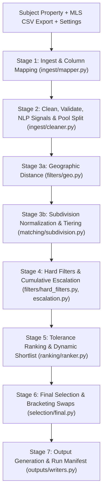

# System Architecture (`comps-pipeline`)

## 1. Architectural Principles

1. **Deterministic Python Math:** No AI models or stochastic processes are in the decision path. Every distance, filter boundary, tolerance band, rank, and bracketing swap is computed in pure Python. Given identical inputs and settings, the engine produces byte-identical output files across runs.
2. **Never Guess or Impute:** Missing or unparseable data becomes an explicit `Cell(value=None)` accompanied by a structured `Flag` (`MISSING_REQUIRED_FIELD` or `INVALID_VALUE`). No values are defaulted or silently fabricated.
3. **Exact Boundary Arithmetic:**
   - Living area (GLA) brackets evaluate integer products (`living_area * 100` vs `subject_gla * (100 ± pct)`), preventing floating-point boundary errors.
   - Lot sizes (acres/sq ft), bathroom counts (`full + half / 2`), and ranking tolerance buckets use exact `fractions.Fraction` arithmetic.
4. **Zero Hardcoded Business Rules:** All thresholds, filter boundaries, escalation steps, ranking hierarchies, tolerance bands, and flag severities reside in `config/settings.yaml`, `config/column_mapping.yaml`, and `config/subdivision_aliases.yaml`. Pydantic models with `extra="forbid"` validate all configurations at startup.
5. **Reference Date Determinism:** Lookback windows (e.g. 12-month sale recency) and future-date validations are evaluated against `subject.effective_date` (the appraisal effective date), never the system clock.
6. **Local & Stateless Web Interface:** The Django web app (`web/`) operates without a database (`DATABASES = {}`). It validates forms, invokes `pipeline.run()`, and renders results directly from run folders in `data/output/<run_id>/`.

---

## 2. Pipeline Execution Stages (`pipeline.run`)



### Stage 1: Ingest & Column Mapping (`comps_pipeline.ingest.mapper`)
- Reads raw CSV files using multi-encoding detection (`utf-8-sig`, fallback to `cp1252`).
- Maps arbitrary client MLS headers to standard internal field names using candidate lists defined in `config/column_mapping.yaml`.
- Unknown or extra CSV columns are preserved verbatim in `comp.extras` for downstream filtering, guardrails, and audit logging.

### Stage 2: Clean, Validate, NLP Signals & Pool Split (`comps_pipeline.ingest.cleaner`, `ingest.remarks`)
- Parses values into strongly typed `Cell[T]` containers (`value`, `source`, `flag`, `note`).
- Normalizes prices, GLA, dates, room counts, and foundation types. Flags unparseable numbers, non-integers, negative amounts, or sale dates occurring after `effective_date`.
- Deduplicates rows on `mls_number` (preserving the first row encountered and flagging subsequent instances as `DUPLICATE_LISTING`).
- Extracts NLP signals from `public_remarks` and `agent_remarks`:
  - Accessory Dwelling Units (`_has_adu` -> `ADU_DETECTED` flag).
  - Unverified or leased solar panels (`_solar_status` -> `SOLAR_LEASE_REVIEW` flag).
  - Non-conforming garage conversions (`_garage_conversion` -> `NON_CONFORMING_CONVERSION` flag).
  - Site and water influences (`_site_influences` -> `SITE_INFLUENCE_NOTE` flag).
  - Distressed sale keywords (cash-only, fixer, investor special) and 55+ community tags.
- Splits valid rows into candidate pools:
  - **Sold Pool (`"sold"`):** Closed transactions requiring `close_price` and `close_date`.
  - **Listing Pool (`"listing"`):** Active, option, or pending listings (`list_price` used, no close date needed).
  - Any unrecognized status is dropped with `STATUS_NOT_USED`.

### Stage 3a: Geographic Distance (`comps_pipeline.filters.geo`)
- Computes great-circle distance in miles via the Haversine formula using `EARTH_RADIUS_MILES = 3958.8` when both subject and comp coordinates are known (`source = Source.COMPUTED`).
- Falls back to the export's reported distance column when coordinates are missing (`source = Source.MLS`).
- If neither is available, sets `distance_miles = None` and raises a `NO_COORDINATES` review flag.

### Stage 3b: Subdivision Normalization & Tiering (`comps_pipeline.matching.subdivision`)
- Normalizes subdivision names: strips noise words (`SUBDIVISION`, `SUB`, `ADDN`), standardizes Roman numerals, and extracts phase, section, and unit numbers.
- Computes matching tiers:
  - **Tier 0 (Exact):** Normalized strings match identically.
  - **Tier 1 (Alias):** Match confirmed via `config/subdivision_aliases.yaml`.
  - **Tier 2 (Fuzzy):** RapidFuzz token sort ratio meets `subdivision_min_score` (default `90`), raises `SUBDIVISION_UNCERTAIN` flag.
  - **Tier 3 (Different):** Mismatched subdivision or conflicting phase/section numbers.

### Stage 4: Hard Filters & Cumulative Escalation (`comps_pipeline.filters.hard_filters`, `filters.escalation`)
- Evaluates baseline eligibility rules:
  - **GLA Bracket:** Living area within ±`gla_bracket_pct`% (default `25%`) using exact scaled integer math.
  - **Lot Size Bracket:** Comp lot within ±`lot_bracket_pct`% (default `25%`) of subject lot in acres using `Fraction` math.
  - **Maximum Distance:** Comps within `max_distance_miles` (default **`1.0` mile** before escalation).
  - **Hard Price Bracket Gate:** Comps with prices outside ±`price_bracket_pct`% (default `50%`) of the subject benchmark valuation $V_{subject}$ (`contract_price` or `estimated_value`) are excluded using pure integer boundary math.
  - **Sale Recency:** Closed within `sale_date_max_months` (default `12` months before `subject.effective_date`).
  - **Market Guardrails & Gates:**
    - Excludes distressed properties (REO, Short Sale, cash-only fixers).
    - Enforces 55+ certified community restrictions.
    - Requires matching story counts (single-story vs 2-story).
    - Requires compatible property sub-types (never mixes SFR with mobile/manufactured/condo).
    - Enforces foundation compatibility (Slab vs Crawl Space / Pier & Beam).
    - Enforces school district (ISD) matching when both are known.
    - Enforces water/sewer compatibility (City Sewer vs Septic).
    - Filters out stale active listings exceeding `max_active_dom`.
- **Cumulative Escalation & New Construction Quotas:**
  - Standard Mode: If fewer than `min_shortlist_size` (default **`25`**) sold comps pass, the engine applies `escalation.steps` cumulatively.
  - **New Construction Mode (`is_new_construction`):** Escalation also requires satisfying the subdivision allocation quotas: $\ge 2$ sold and $\ge 1$ active in-subdivision (Tiers 0/1), and $\ge 1$ sold and $\ge 1$ active out-of-subdivision (Tiers $\ge$ 2). If any quota is deficient, the engine escalates radius (2.0 -> 3.0 -> 4.0 -> 5.0 mi), GLA, and lookback to capture candidates. If still deficient after all steps, it logs a `NEW_CONST_SUBDIVISION_DEFICIT` flag.
  - Escalation steps applied cumulatively:
  1. `max_distance_miles: 2.0`
  2. `max_distance_miles: 3.0`
  3. `max_distance_miles: 4.0`
  4. `max_distance_miles: 5.0`
  5. `gla_bracket_pct: 30`
  6. `sale_date_max_months: 24`
- Each step used adds a `CRITERIA_RELAXED` review flag. If fewer than 25 sold comps remain after all steps, ranking raises a `SHORTLIST_BELOW_MINIMUM` blocking flag (exit code 2).

### Stage 5: Multi-Criteria Ranking & Dynamic Shortlist (`comps_pipeline.ranking.ranker`)
- Evaluates priority gates and sort keys for each pool:
  1. Listing status priority (Pending / Option ranked ahead of Active).
  2. Financing terms priority (Conventional / FHA / VA ranked ahead of Seller / Owner financing).
  3. 7-key hierarchy with tolerance bands (`subdivision`, `distance`, `gla`, `age`, `lot`, `beds`, `baths`). Values inside the same tolerance band count as a tie, allowing the next priority to decide.
  4. Purchase contract price proximity (5% price bands when `transaction_type == "purchase"`).
  5. Feature matching priority (Pool and ADU alignment).
  6. Deterministic tie-breakers: exact distance, exact GLA diff %, and `mls_number`.
- **New Construction Shortlist Quota Protection:**
  - Guarantees that in New Construction mode, out-of-subdivision comps and in-subdivision comps are not crowded out of the 25–30 shortlist (at least 2 in-sub solds, 2 out-of-sub solds, 1 in-sub listing, 1 out-of-sub listing).
- **Dynamic 25–30 Sold Shortlist (`_is_close_and_good`):**
  - Positions 1 to 25 are always shortlisted to guarantee the minimum quota.
  - Positions 26 to 30 are dynamically shortlisted only if they are **close** (within the 1.0-mile baseline research range with no sudden distance jump from the base comps) and **good** (within GLA bracket %, matching subdivision tier, valid metrics).
  - If quality drops off, the shortlist cleanly terminates between 25 and 30, and the remaining comps are logged as excluded.
  - Listing pool keeps up to `listing_shortlist_size` (default `10`).

### Stage 6: Final Selection & Strict-Improvement Bracketing (`comps_pipeline.selection.final`)
- **New Construction (C1) Selection Path:**
  - Selects 2 Sold + 1 Active from inside the subdivision (`tier in (0, 1)`).
  - Selects 1 Sold + 1 Active from outside the subdivision (`tier not in (0, 1)`).
  - Selects 1 additional Sold from either pool (total 6 comps: 4 Sold + 2 Listings).
  - Swaps strictly protect the 2 In-Sub / 1 Out-of-Sub quotas. Deficits log `NEW_CONST_SUBDIVISION_DEFICIT`.
- **Standard Selection Path:**
  - Selects the top `sold_count` (5) sold comps and `listing_count` (1) listing from the top of the shortlists.
- Evaluates bracketing on configured attributes (`gla`, `lot`, `age`, `beds`, `baths`), requiring at least one comp strictly above and one strictly below the subject.
- **Strict-Improvement Swap Algorithm:** If unbracketed attributes exist, iterates through remaining shortlisted sold comps in rank order and tests swapping them for the lowest-ranked sold picks. A swap is accepted if and only if the resulting gap set is a **strict subset** (`set(new_gaps) < set(current_gaps)`). Listing picks are never swapped. Unresolvable gaps emit `NOT_BRACKETED` review flags.

### Stage 7: Output Generation & Run Manifest (`comps_pipeline.outputs.writers`)
- Generates immutable, auditable run artifacts in `data/output/<run_id>/`:
  - `final_selection.csv` / `final_selection.json`: The final 5 sold + 1 listing appraisal comps.
  - `shortlist.csv` / `shortlist.json`: The full ranked sold shortlist (25–30) followed by the listing shortlist.
  - `excluded.csv`: Every excluded input row with its 1-based source row, exclusion stage, and all failing reasons.
  - `flags.csv` / `flags.json`: Diagnostic flags with severity, message, and evidence.
  - `audit.jsonl`: Line-by-line machine-readable decision log recording every `KEPT`, `EXCLUDED`, `FLAGGED`, and `RANKED` action.
  - `run_manifest.json`: Run metadata, input file SHA-256 hashes, config snapshot, stage durations, and escalation history.
  - `subject.json`: Validated subject property specification.

---

## 3. Web Application Architecture (`web/`)

The web UI is built with stateless Django and styled with modern CSS:

| Route | View Name | Template | Purpose |
|---|---|---|---|
| `GET / POST /` | `new_run` | `new_run.html` | Modular subject property intake form, MLS CSV file upload or sample selector, execution trigger. |
| `GET / POST /config/` | `config_view` | `config.html` | 6-module Configuration Studio for editing `settings.yaml`, `column_mapping.yaml`, and `subdivision_aliases.yaml` with automatic `.yaml.bak` backups. |
| `GET /runs/<run_id>/` | `results` | `results.html` | Appraisal comparison grid with visual bracket indicators (`▲`, `▼`, `=`), 6-stage execution trace, shortlists, flag badges, and excluded row tables. |
| `GET /runs/` | `history` | `history.html` | Historical run archive discovered from `data/output/`, sorted newest first. |
| `GET /runs/<run_id>/files/<name>` | `download` | *N/A* | Safe streaming download endpoint for run artifacts. |

---

## 4. Domain Data Model

```text
Cell[T]
├── value: T | None
├── source: Source ("MLS" | "COMPUTED" | "NONE")
├── flag: FlagReason | None
└── note: str | None

Comp
├── mls_number: str
├── source_row: int
├── pool: "sold" | "listing"
├── standard_fields: Cell[T] (18 core fields: living_area, close_price, year_built, etc.)
├── extras: dict[str, Any] (unmapped columns, e.g. Foundation, Amenities)
├── computed_metrics: Cell[T] (distance_miles, gla_diff_pct, age_diff_years, lot_diff_pct)
├── remarks_signals: dict[str, Any] (NLP extracted attributes)
├── rank: int | None
└── sort_key: list[Any] | None

Subject
├── address, living_area, subdivision, effective_date
├── optional coordinates: latitude, longitude
├── optional specs: year_built, lot_size_sqft, lot_size_acres, bedrooms, baths_full, baths_half
├── optional amenities & context: pool, has_adu, foundation_type, is_55_plus, transaction_type, contract_price
└── extras: dict[str, Any]

Flag
├── id: str ("F0001", "F0002", ...)
├── mls_number: str | None
├── field: str | None
├── reason: FlagReason (13 standardized reasons)
├── severity: Severity (INFO | REVIEW | BLOCKING)
├── origin: FlagOrigin
├── message: str
└── evidence: str | None
```

---

## 5. Architectural Invariants

1. **Shortlist Integrity:** Sold shortlist count is guaranteed between `min_shortlist_size` (25) and `shortlist_size` (30) when candidates exist; drops below 25 trigger escalation and then a BLOCKING flag if exhausted.
2. **Deterministic Sort Keys:** Every comp's sort key concludes with `c.mls_number`, guaranteeing that no two comps ever compare equal in Python sort operations.
3. **Audit Trail Completeness:** The sum of shortlisted comps and excluded rows always equals the total number of input rows (`len(shortlist) + len(excluded) == input_rows`).
4. **Safety & Permissions:** All file operations are constrained to local disk directories (`data/output/`, `config/`), preventing remote egress or data exposure.
